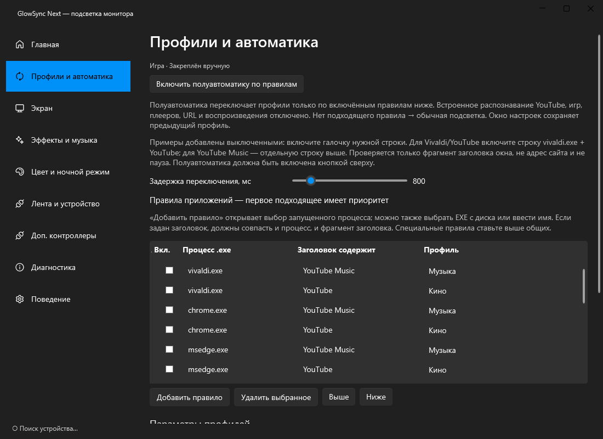

# GlowSync Next

Ambilight-подсветка для игр, кино и музыки на Windows. Цвета по краям экрана передаются на ленту; несколько USB- и сетевых контроллеров могут работать одновременно.

**Windows 10 2004+ / 11 x64 · версия 0.3.3 · MIT**

[Скачать 0.3.3](https://github.com/jeronimo701/GlowSyncNext/releases/tag/v0.3.3) · [Инструкция](GUIDE.ru.md) · [Изменения](RELEASE-NOTES.md) · [Проблемы](https://github.com/jeronimo701/GlowSyncNext/issues)



*Интерфейс Next 0.3.3, отрисованный штатным UI-тестом. Захват экрана, звук и отправка на устройства при съёмке не запускались.*

## Что умеет

- Экранная подсветка, музыкальный режим, один цвет, радуга, переливание, дыхание и комета.
- Профили «Игра», «Кино», «Музыка» и «Обычная подсветка».
- Полуавтоматическое переключение по заданным правилам процесса и заголовка окна.
- Skydimo и Adalight по USB; WLED/DDP, TPM2.NET и OPC по сети.
- Основной и до восьми дополнительных выходов, диагностика захвата и отправки.

[Настройка нескольких выходов](docs/screenshots/outputs.png)

## С чего начать

1. Скачай готовую сборку из [Releases](https://github.com/jeronimo701/GlowSyncNext/releases/tag/v0.3.3) и запусти `GlowSync.Next.exe`. Для обычной сборки нужен .NET 8 Desktop Runtime.
2. Закрой другие приложения, использующие тот же COM-порт. Выбери протокол и устройство.
3. Введи число светодиодов по сторонам и запусти тест сторон. Сумма раскладки должна совпадать с количеством LED.
4. Выбери экран, яркость и режим. Правила приложений включай по одному и проверяй результат.

Настройки находятся в `%LOCALAPPDATA%\GlowSyncNext`; конфиг оригинального GlowSync не перезаписывается.

## О частоте кадров и автоматике

60 FPS в настройках — цель, а не обещание для любого контроллера. Например, 81 RGB LED при 115200 бод дают расчётный безопасный предел около 41,6 FPS. Важны протокол, скорость порта и сама прошивка.

Распознавания YouTube и фильмов по содержимому сайта нет: действуют включённые правила процесса/заголовка. Примеры правил изначально выключены. Для матриц пока используется общая карта и её сегменты, не независимая 2D-раскладка на каждый выход.

## Сборка и проверка

Для сборки нужен .NET SDK 8:

```powershell
git clone https://github.com/jeronimo701/GlowSyncNext.git
cd GlowSyncNext
.\build.ps1
```

Готовая папка: `artifacts/release/GlowSyncNext-0.3.3-win-x64/`. Дополнительные параметры и подробности — [DETAILS.ru.md](DETAILS.ru.md). Отчёт тестов — [TEST-REPORT.md](TEST-REPORT.md). UI-тест повторно пройден при обновлении README.

Версия предварительная: физическую совместимость контроллера, HDR, сон/пробуждение и задержку до LED нужно проверять на оборудовании. Прошивки устройств этой доработкой не меняются.

## Откуда появился проект

Развитие [GlowSync от skybots-tg](https://github.com/skybots-tg/glowsync). Исходное авторство и **MIT** сохранены, включая разрешённое лицензией коммерческое использование. [LICENSE](LICENSE) · [Пояснение по лицензии](LICENSING.ru.md) · [Компоненты](THIRD-PARTY.md). Старое описание оригинала сохранено в [DETAILS.ru.md](DETAILS.ru.md) и не является инструкцией к Next.
